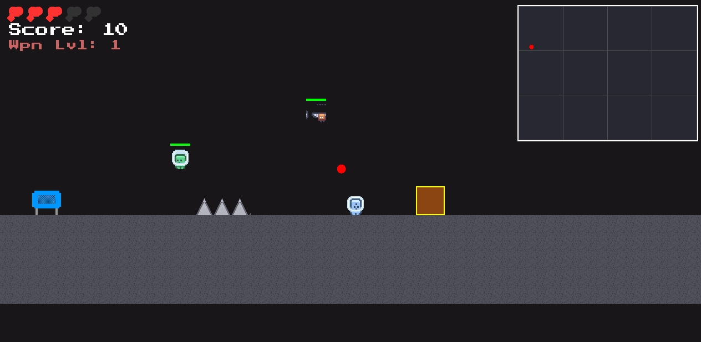
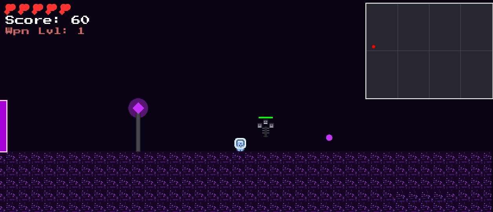

# Metroidvania C++: Echoes of the Abyss

[](https://isocpp.org/)
[](https://cmake.org/)
[](https://www.sfml-dev.org/)
[](https://visualstudio.microsoft.com/)

A feature-rich 2D Metroidvania platformer built from scratch in C++ with SFML.

Полноценный 2D-платформер с элементами метроидвании, написанный с нуля на C++ с использованием библиотеки SFML.

---

## 🎬 Demo


*Real-time gameplay: smooth physics, dash mechanics, and procedural graphics.*

---

## 🇬🇧 English

### About
**Metroidvania C++** is a complete 2D platformer with Metroidvania elements, developed entirely from scratch. This project was created to demonstrate advanced C++ skills, game engine architecture, procedural generation, and Object-Oriented Programming (OOP).

### Screenshots

| Exploring the Caves | Boss Fight in the Void |
|:---:|:---:|
|  |  |

| Dash Mechanic | Ice Physics |
|:---:|:---:|
|  |  |

### Features

- **Custom Physics & Collisions:** AABB collision detection, double jump, wall-sliding, and dashing with cooldown mechanics.
- **5 Unique Biomes:**
  - 🦇 **Sinister Caves:** Core mechanics.
  - 🌲 **Green Glade:** Platforming & kamikaze enemies.
  - 🌕 **Moonlight:** Altered low-gravity physics.
  - ❄️ **Frozen Caves:** Ice sliding, falling spikes.
  - 🌌 **Distorted Abyss:** Teleportation pads, acid pits, unique bosses.
- **Advanced Enemy AI:** Shooters, flying bats, jumping slimes, laser turrets, ice mages, and a **Three-Headed Horror** (featuring a "Leash" mechanic to return to spawn points).
- **Procedural Graphics:** All custom textures (coins, mages, the Void Horror, environmental tiles) are generated in RAM using `sf::Image` at runtime without external assets.
- **RPG & Inventory System:** Collect resources (coins, herbs, ore), craft (upgrade sword with ore), heal (potions), and a checkpoint system.

### Technical Architecture
The project follows a clean Separation of Concerns:
- `src/core` — Game Loop, Input handling, Math (`Vector2`).
- `src/entities` — Game objects (Player, Enemy, Level, Collectible, Pickup).
- `include/` — Header files, interfaces, and data structures.

**Highlighted Technical Solutions:**
1. **Render Optimization:** Utilized `sf::View` for a smooth camera and frustum culling.
2. **Memory Management:** Used `std::vector` with iterators for safe object deletion (bullets, enemies) during the game loop without memory leaks.
3. **Texture Management:** Static methods in `Collectible` and `Enemy` guarantee that heavy textures are loaded into memory exactly once.

### Controls

| Key | Action |
| :--- | :--- |
| **Move** | `A` / `D` or `←` / `→` |
| **Jump** | `Space` or `W` |
| **Attack** | `J` or `LMB` |
| **Dash** | `LShift` / `RShift` |
| **Interact** | `E` (Chests, Checkpoints) |
| **Inventory** | `I` |
| **World Map** | `M` or `Tab` |
| **Heal (Use Herb)** | `H` (in Inventory) |
| **Upgrade Weapon** | `U` (Costs 3 Ore) |

### Getting Started

#### Prerequisites
- Visual Studio 2022 ("Desktop development with C++")
- CMake 3.20+
- vcpkg

#### Build
1. Install dependencies:
   ```bash
   vcpkg install sfml gtest
   ```
2. Clone:
   ```bash
   git clone https://github.com/Bloodmoon001/Metroidvania-C-Echoes-of-the-Abyss.git
   cd Metroidvania-C-Echoes-of-the-Abyss
   ```
3. Open the folder in Visual Studio (`File` → `Open` → `Folder`).
4. Select `x64-Release`, build with `Ctrl+Shift+B`.

#### Running
Launch `app.exe` from the `bin/` folder. *(Assets are automatically copied via POST_BUILD CMake command).*

### License
MIT License. See `LICENSE`.

---

## 🇷🇺 Русский

### О проекте
**Metroidvania C++** — это полноценный 2D-платформер с элементами метроидвании, написанный с нуля. Проект создан для демонстрации навыков объектно-ориентированного программирования (ООП), разработки игровых движков, процедурной генерации графики и архитектуры игровых систем.

### Скриншоты

| Исследование пещер | Битва в Бездне |
|:---:|:---:|
|  |  |

| Механика Рывка | Физика льда |
|:---:|:---:|
|  |  |

### Возможности

- **Собственная физика и коллизии:** AABB-коллизии, двойной прыжок, скольжение по стенам (Wall-Slide), рывок (Dash) с кулдауном.
- **5 уникальных биомов:**
  - 🦇 **Sinister Caves:** Базовые механики.
  - 🌲 **Green Glade:** Платформинг и враги-камикадзе.
  - 🌕 **Moonlight:** Изменённая гравитация.
  - ❄️ **Frozen Caves:** Скольжение по льду, падающие сосульки.
  - 🌌 **Distorted Abyss:** Телепорты, кислотные ямы, уникальные враги.
- **Продвинутый ИИ врагов:** Стрелки, летающие мыши, прыгающие слаймы, лазерные турели, ледяные маги и **Трехглавый Ужас** (с механикой "Leash" — возвращение на точку спавна).
- **Процедурная графика:** Все уникальные текстуры (монеты, маги, Ужас Бездны, окружение) генерируются в оперативной памяти с помощью `sf::Image` при старте игры, не требуя внешних ассетов.
- **Инвентарь и RPG-элементы:** Сбор ресурсов (монеты, травы, руда), крафт (улучшение меча), лечение, система чекпоинтов.

### Техническая архитектура
Проект имеет четкое разделение на слои (Separation of Concerns):
- `src/core` — Игровой цикл (Game Loop), ввод, математика.
- `src/entities` — Игровые сущности (Player, Enemy, Level, Collectible).
- `include/` — Заголовочные файлы и интерфейсы.

**Интересные технические решения:**
1. **Оптимизация рендера:** Использование `sf::View` для плавной камеры и отрисовки только видимой области.
2. **Управление памятью:** Использование `std::vector` с итераторами для безопасного удаления объектов (пули, враги) во время игрового цикла без утечек памяти.
3. **Иммутабельность текстур:** Статические методы гарантируют, что тяжелые текстуры загружаются в память ровно один раз.

### Управление

| Клавиша | Действие |
| :--- | :--- |
| **Движение** | `A` / `D` или `←` / `→` |
| **Прыжок** | `Space` или `W` |
| **Атака** | `J` или `ЛКМ` |
| **Рывок (Dash)** | `LShift` / `RShift` |
| **Взаимодействие** | `E` (сундуки, чекпоинты) |
| **Инвентарь** | `I` |
| **Карта мира** | `M` или `Tab` |
| **Лечение (Трава)** | `H` (в инвентаре) |
| **Улучшение меча** | `U` (нужно 3 руды) |

### Сборка и запуск

#### Требования
- Visual Studio 2022 («Разработка классических приложений на C++»)
- CMake 3.20+
- vcpkg

#### Сборка
1. Установите зависимости:
   ```bash
   vcpkg install sfml gtest
   ```
2. Склонируйте:
   ```bash
   git clone https://github.com/Bloodmoon001/Metroidvania-C-Echoes-of-the-Abyss.git
   cd Metroidvania-C-Echoes-of-the-Abyss
   ```
3. Откройте папку в Visual Studio (`Файл` → `Открыть` → `Папка`).
4. Выберите `x64-Release`, соберите через `Ctrl+Shift+B`.

#### Запуск
Запустите `app.exe` из папки `bin/`. *(Ассеты копируются автоматически благодаря POST_BUILD в CMake).*

### Лицензия
MIT License. См. файл `LICENSE`.

---

## 👨‍💻 Author / Автор

**Bloodmoon001**
- GitHub: [@Bloodmoon001](https://github.com/Bloodmoon001)